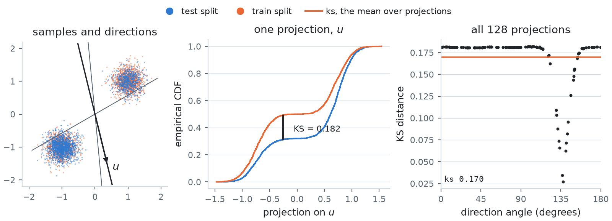

# Metrics

Every metric compares samples against a reference ensemble. Importance weights are an optional
argument, normalised inside; no metric is computed from the weights alone or from a model's own
density, so there is no effective sample size, `log Z` error, NLL or bits per dimension.

## `compute_metrics`

```python
metrics = target.compute_metrics(samples, weights=None, ref_samples=None,
                                 compute_standard_metrics=True, skip_costly_metrics=True,
                                 generator=None, return_hist=False)
```

- `samples`, `weights` and `ref_samples` are cast to the target's dtype and device first.
- `ref_samples` defaults to the target's test split at the size of `samples` (exact draws are seeded
  at 0, so a reported number is reproducible). Pass a larger or different reference explicitly.
- `generator` is a CPU `torch.Generator` that draws the random projections of the sliced metrics and
  the rows of the quadratic ones. `None` seeds one at 0, so the panel repeats exactly.
- `return_hist=True` also returns what the scalars rest on: `{'edges', 'hist', 'ref_hist'}` for a
  histogram, the empirical mode weights for a mode panel, per-coordinate moments for a posterior.
  A peptide returns one such dict per panel, under `'torsions'`, `'dist'`, `'energy'` and
  `'upstream'` (see the peptide page).

Each target's panel is listed on its family page: [synthetic](targets/synthetic.md#metric-panel),
[particles](targets/particles.md#metric-panel), [posteriors](targets/posteriors.md#metric-panel),
[peptides](targets/peptides.md#metric-panel), [glass formers](targets/glasses.md#metric-panel).

## The standard panel

The synthetic targets, whose coordinates compare directly, report it before their own panel
(`standard_panel = True`). Particle, glass and peptide configurations are defined only up to
translation, permutation, rotation or periodic image, so those targets report an invariant panel
instead. `metrics.compute_standard_metrics` can still be called directly on any samples.

| Metric | Definition |
| --- | --- |
| `ks` | sliced Kolmogorov-Smirnov: the exact two-sample KS distance on each of 128 random projections, averaged |
| `w2_sliced` | sliced Wasserstein-2 |
| `mmd` | Gaussian-kernel MMD with the median-heuristic bandwidth, the unbiased U-statistic |
| `w2` | exact Wasserstein-2 |
| `n_costly_samples` | the number of rows per side `mmd` and `w2` were computed on |

`ks` sorts each projection and compares the two weighted empirical CDFs at every sample point, so
nothing is binned or dropped. A row with a non-finite coordinate is placed at whichever end of
each projection gives the larger distance, so non-finite rows can only raise `ks`.

<picture>
  <source media="(prefers-color-scheme: dark)" srcset="figures/images/metrics_sliced_ks_dark.png">
  
</picture>

`ks` on `TwoModes`: the train split, which puts most of its mass in the light mode, against the
test split at the true 2/3 : 1/3; the left panel draws a subsample of each. Along the direction `u`
the largest gap between the two projected CDFs is the difference between the two splits' weights of
the heavy mode. `ks` is the mean of that gap over the 128 directions the panel draws. Directions
near 135 degrees, orthogonal to the line through the two modes, project both modes onto one point
and see almost no difference.

`mmd` and `w2` are quadratic, so they are computed only with `skip_costly_metrics=False`, on
`n = min(len(samples), len(ref_samples), max_costly_samples)` rows per side, `max_costly_samples`
being 2000. The rows are drawn with `generator`, never sliced off the front, so a chain is scored on
all of its states. The reference side is a uniform subset. The scored side is one too when it is
unweighted; with weights it is `n` rows drawn in proportion to them by systematic resampling
(`metrics.subsample`), so both metrics compare two unweighted sets. The peptide panel draws the
`max_ot_samples` rows of `torus_w2`, `tica_w2` and `tica_k_jsd` the same way.

**WARNING: `tica_k_jsd` barely sees the alpha-R / beta split.** Its k-means runs on the raw TICA
coordinates, as `transferable-samplers` runs it, and TIC 1 spreads 90 times wider than TIC 2 on
Ace-A-Nme, so the 20 clusters are bands across TIC 1 while alpha-R and beta differ along TIC 2.
Reference structures with every alpha-R one removed (41% of the ensemble) read 0.014 against a
floor of 0.004, where `torus_k_jsd` reads 0.237 against 0.002. The number is kept as upstream
defines it, so that it compares with theirs; read basin populations off `torus_k_jsd` and the
torsion panel.

## Mode coverage

Every target with a discrete mode descriptor (the mixtures, `Rings`, `Checkerboard`, `ManyWell`
per well) reports four numbers on the empirical mode weights:

| Metric | Definition |
| --- | --- |
| `emc` | entropy of the empirical mode weights divided by `log(n_modes)` |
| `kl_weights` | `KL(true weights \|\| empirical weights)`, infinite when a mode gets no mass |
| `tv_weights` | `sum_k \|empirical_k - true_k\|`, twice the total variation distance |
| `perc_forgotten_modes` | fraction of modes holding less than 5% of the smallest true weight |

The [synthetic page](targets/synthetic.md#metric-panel) draws the four on GMM-40 for three samplers
that fail in different ways.

On the mixtures (`GMM40`, `MoS`, `TwoModes`, `BracketTwoModes`, `ManyModes`, `EightGaussians`) the
empirical weight of component `k` is the (weighted) mean of its responsibility
`w_k pi_k(x) / sum_j w_j pi_j(x)` over the samples. Under exact draws its expectation is `w_k`
whether or not the components overlap. `Rings`, `Checkerboard` and `ManyWell` count labels: the
nearest ring, the square, the side of each well.

`tv_weights` is never 0 on a finite sample. On `K` equally weighted, well separated modes exact draws
read about `sqrt(2 K / (pi n))`, the mean absolute deviation of a multinomial: on GMM-40, 0.110 at
n = 2048, 0.048 at 10^4 and 0.015 at 10^5 over 20 seeds, against 0.112, 0.050 and 0.016 from the
formula. Read a sampler's number against that floor at its own `n`.

## Binning

- **Particle distances** follow `jarridrb/DEM`: 200 equal-width bins over the reference distances'
  own range, the samples binned on the same edges, each side renormalised.
  `tests/test_metrics.py` reproduces DEM's value to 1e-12. Mass that falls outside the reference
  range is dropped by that protocol, so every total variation comes with its dropped mass,
  `*_out_of_range`; the `*_w1` metrics need no binning. A sample with all of its mass outside
  reads a total variation of 1 and an `*_out_of_range` of 1.
- **Energy total variations saturate at 1** once the two sets no longer overlap, so past that point
  only `energy_w1` still ranks samplers.
- **Particle energies** use 100 bins over the ranges DEM fixes per system: `(-26, 0)` for DW-4,
  `(-60, 0)` for LJ-13, `(-380, -180)` for LJ-55.
- **Glass distances** use edges pinned by the box, from 0 to `L / sqrt(2)`, so nothing is dropped.
  Glass energies are per particle.
- **Peptide torsion divergences** use 64 bins per marginal and a 32 x 32 Ramachandran joint, with
  `ramachandran_occupancy` reporting how much of that grid the reference fills. The 200 x 200 grid
  is returned for plotting only: at realistic sample sizes it is mostly empty, and two halves of the
  same ensemble would read as different.
- **Jensen-Shannon divergences** are the squared Jensen-Shannon distance in base 2,
  `scipy.spatial.distance.jensenshannon(p, q, base=2) ** 2`.

There is no generic sample-level TVD, KL or JSD: no binning rule is defensible in 1600 dimensions,
so histogram metrics exist only where the binning is fixed by the observable.

## Building blocks

`samplingdb.metrics` exposes the pieces the panels are built from:

| Function | Use |
| --- | --- |
| `compute_sliced_ks`, `compute_mmd`, `compute_wasserstein_distance`, `compute_sliced_wasserstein_distance` | the standard panel |
| `wasserstein_distance_1d` | weighted 1D Wasserstein, exact for powers 1 and 2 and safe with repeated values |
| `torus_wasserstein` | exact transport with the periodic per-coordinate distance |
| `circular_wasserstein_1d` | exact 1D Wasserstein-1 on the circle, invariant to where the circle is cut |
| `weighted_histogram`, `histogram_2d`, `compare_histograms`, `reference_edges`, `shared_edges` | histograms on fixed or shared edges, with the out-of-range mass |
| `histogram_tvd`, `histogram_kl`, `jensen_shannon` | divergences between histograms |
| `compute_structure_metrics` | the distance and energy panel the structured targets share |
| `kmeans`, `kmeans_jsd`, `fit_tica`, `TicaModel`, `wrap_angles` | the molecular features |
| `normalize_weights` | `None` becomes uniform weights |
| `subsample` | `n` unweighted rows of a weighted set, as the quadratic metrics use |
