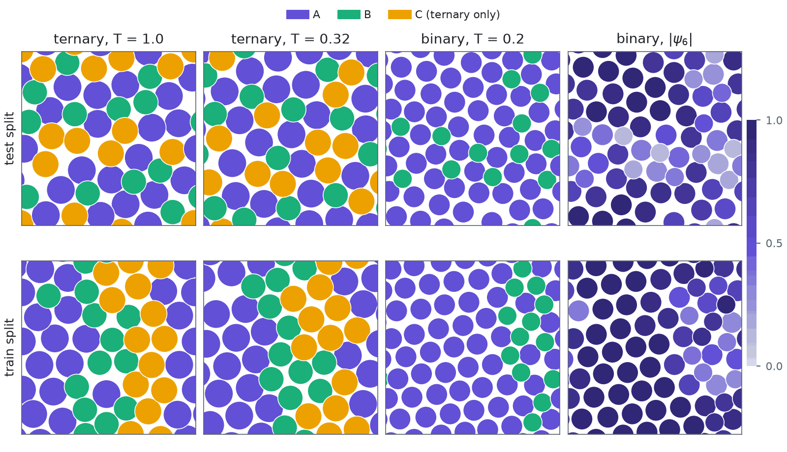
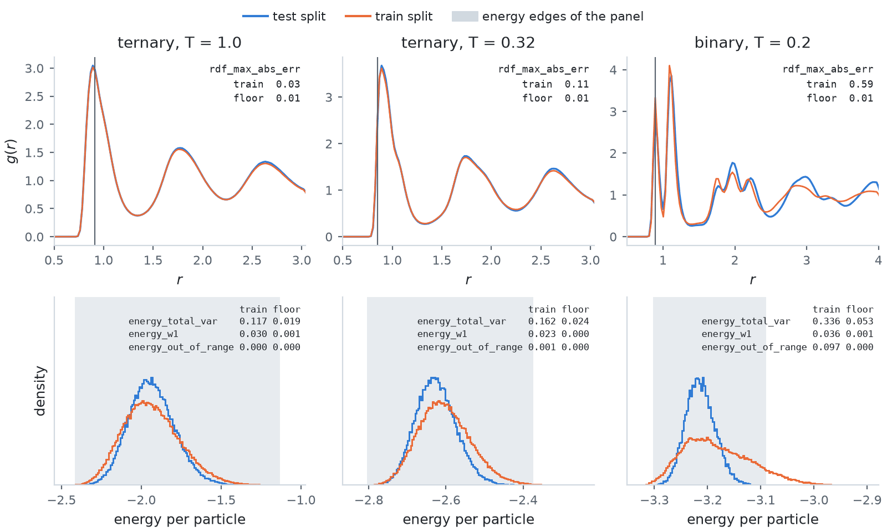
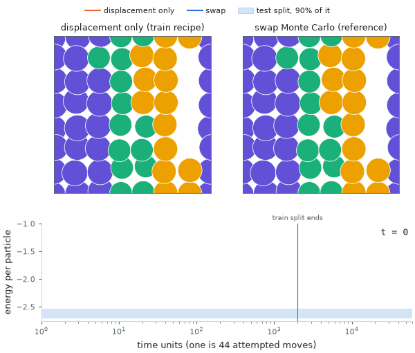

# Glass formers (Tier 4)

Two-dimensional Kob-Andersen mixtures on a periodic square box, where the question is whether a
sampler reaches equilibrium at all. `log_prob(x) = -E(x) / T`, with `E` the total pair energy over
unordered pairs. They work in float32.

| | `KobAndersen2D` | `KobAndersenBinary` |
| --- | --- | --- |
| composition | ternary 5/11 : 3/11 : 3/11 (Jung et al. 2023) | binary 80:20 (Cheng et al. 2026) |
| particles, density | 44 at `rho = 1.192075` | 64 (51 A, 13 B) at `rho = 1`, so the box side is 8 |
| dim | 88 | 128 |
| pair parameters | `eps` and `sigma` 3 x 3 matrices, pinned in the class | `(eps, sigma)` = (1, 1) for AA, (1.5, 0.8) for AB, (0.5, 0.88) for BB |
| cutoff at `2.5 sigma` | smoothed: the potential and its first two derivatives vanish | shifted: the potential vanishes, the force jumps |
| swap moves | effective, A<->C and B<->C | ineffective, which is the point of this system |
| temperatures | 0.32 and 1.0 | 2.0, 0.5 and 0.2; the catalog ships 0.2 |
| `name` | `ka-ternary-N44-T<T>` | `ka-binary-N64-T<T>` |

<picture>
  <source media="(prefers-color-scheme: dark)" srcset="../figures/images/glasses_configurations_dark.png">
  
</picture>

One configuration of each split for every catalogued system, in the periodic box, each particle a
disc of diameter `sigma_ii`. The train split starts from a square lattice filled in species order,
and its 2000 time units of displacement moves leave that order in place: the ternary species stay in
blocks at both temperatures, and the binary's B particles stay in the rows the lattice gave them (a
median of 44% of a B particle's six nearest neighbours are B, against 15% in the test split). The
last column shades the binary by its local hexatic order `|psi_6|` over six neighbours. The test
configuration, one of the 16 closest to the set's median crystalline fraction and orientational
coherence, holds an A crystallite next to a disordered region that contains all 13 B particles. The
train configuration is one A crystal nearly everywhere: 69% of its A particles have
`|psi_6| > 0.8`, against 53% in the test split (medians over 512 configurations of each).

## Conventions

- **Total energy.** The density is `exp(-E / T)`, not `exp(-E / (N T))`. The configurations
  released with the ternary model (Zenodo record 17966995) are stationary under the released
  Metropolis kernel with this normalisation and not with the other, and `tests/test_physics.py`
  keeps that check.
- **Smoothing coefficients.** The ternary potential is
  `4 eps [(sigma/r)^12 - (sigma/r)^6 + C0 + C2 (r/sigma)^2 + C4 (r/sigma)^4]` with
  `(C0, C2, C4) = (0.04049023795, -0.00970155098, 0.00062012616)` at the 2.5 cutoff, the values
  that solve W(rc) = W'(rc) = W''(rc) = 0 and those of ParticlesMC's `SmoothLennardJones`. Any other
  `cutoff_factor` solves for its own with `smoothing_coefficients()`.
- **Species order.** Species labels are fixed and canonically ordered: A, then B, then C.
- **Invariant representation.** `preprocess()` returns the sorted minimum-image pair distances, which
  are invariant under translation, permutation and periodic image.
- **The binary mixture at T = 0.2 is partly crystalline.** Its equilibrium state is a hexagonal A
  crystallite spanning the box next to a B-rich amorphous band, the known behaviour of the 2D 80:20
  mixture (Bruening et al. 2009). The density is kept as Cheng et al. 2026 define it, so a sampler
  has to get the crystallite and the band right.

Under swap Monte Carlo, the ternary mixture's structural relaxation time read off the particle
trajectories is about 2 300 time units at T = 0.32 and 265 at T = 1.0. The targets also expose
`rdf`, the radial distribution function the panel compares.

## Metric panel

| Metric | What it compares |
| --- | --- |
| `dist_total_var`, `dist_w1`, `dist_out_of_range` | the minimum-image pair distances |
| `energy_total_var`, `energy_w1`, `energy_out_of_range` | the energies per particle |
| `rdf_max_abs_err` | the radial distribution functions g(r) |

The distance edges are pinned by the box, from 0 to `L / sqrt(2)`, which covers every reachable
minimum-image distance, so `dist_out_of_range` is 0. The energy edges come from the reference.
`return_hist=True` adds `'dist'`, `'energy'` and `'rdf'` (bin centres and both g(r)).

<picture>
  <source media="(prefers-color-scheme: dark)" srcset="../figures/images/glasses_structure_dark.png">
  
</picture>

The panel on the train split (512 configurations) against 4096 test configurations, next to its
floor: 512 further test configurations scored against the same 4096. The vertical line marks the
distance where `|g(r) - g_ref(r)|` peaks, the value `rdf_max_abs_err` reports; the train split's
first peak splits in two at both ternary temperatures. The shaded span is the panel's energy edges,
derived from the reference. Train energies above it are dropped from `energy_total_var` and counted
by `energy_out_of_range`, so the ternary at T = 0.32, whose train energies all fall outside, reads
0.50 there while `energy_w1` reads 0.78 against a floor of 0.003. At 512 configurations on 200
bins, `energy_total_var` has a floor near 0.2.

## Splits

| Split | How it is built |
| --- | --- |
| test, ternary | This library's swap Monte Carlo, `gen/swap_mc/generate.py`, published as `swapmc/<name>_<spec_id>.npy` and downloaded on first use. See [Reference sets](../reference-sets.md#swap-monte-carlo-the-ternary-glass). |
| test, binary | This library's non-reversible parallel tempering, `gen/parallel_tempering/generate.py`, published as `pt/<name>_<spec_id>.npy` and downloaded on first use: 30 720 configurations at T = 0.2, 91% independent (see [Reference sets](../reference-sets.md#parallel-tempering-particles-and-the-binary-glass)). Cheng et al. 2026 published no configurations. |
| train | Displacement-only single-particle Metropolis, `N(0, 0.065^2)` moves, for 2000 time units (one time unit is `N` attempted moves) from a jittered square lattice: the run that shows swap moves are needed, far short of equilibrium at the low temperatures. |

<picture>
  <source media="(prefers-color-scheme: dark)" srcset="../figures/images/glasses_swap_dark.gif">
  
</picture>

The train split's first 64 starting points at T = 0.32, run under the train recipe's kernel
(displacement moves only) and under the swap Monte Carlo kernel that generated the test split. The
boxes show one chain, the curves the mean energy per particle over the 64. With swaps the mean
enters the test split's central 90% within about 500 time units and ends at -2.63 after 10 000,
the test split's median. Without them it is at -1.85 when the train split stops at 2000 time units
and at -1.98 after 10 000, with the lattice's species blocks still in place.
