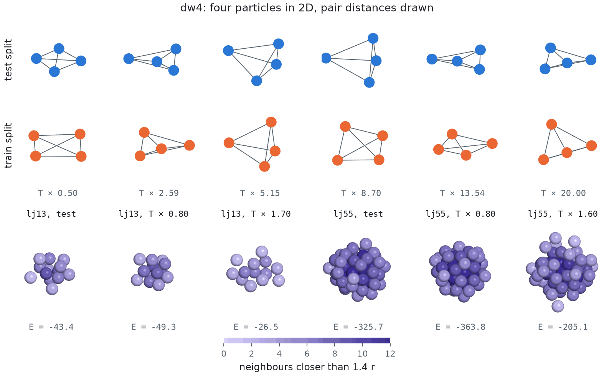
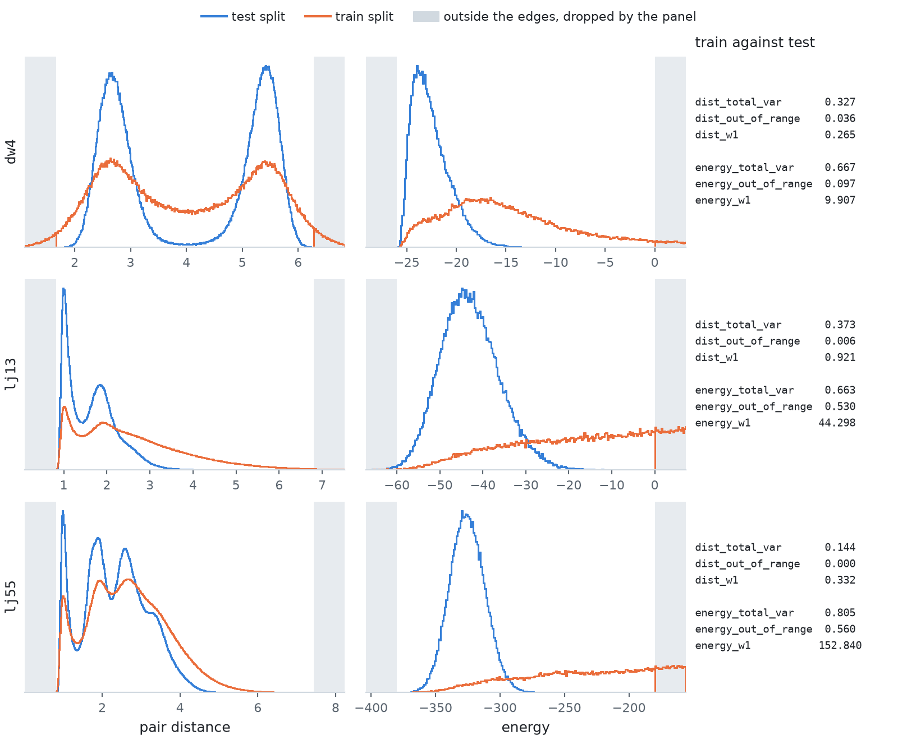
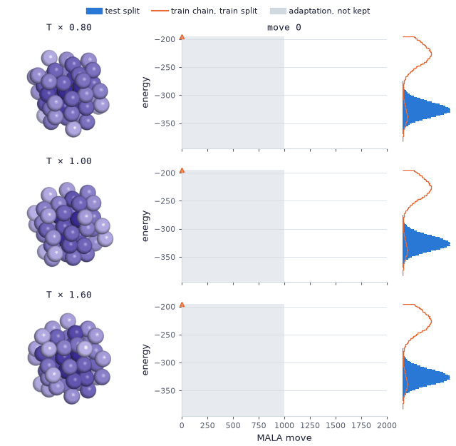

# Particle systems (Tier 1)

Clusters whose energy is invariant to translation, rotation and permutation of the particles. They
work in float32, and `preprocess()` removes the centre of mass before any metric sees them.

| Class | dim | `name` | Energy |
| --- | --- | --- | --- |
| `DW4` | 8 | `dw4` | 4 particles in 2D, `E = sum_{i<j} [a (d_ij - d_0)^4 + b (d_ij - d_0)^2 + c] / tau` with `(a, b, c, d_0, tau) = (0.9, -4, 0, 4, 1)` |
| `LJ13` | 39 | `lj13` | 13 particles in 3D, `E = (eps / tau) sum_{i != j} [(r / d_ij)^12 - 2 (r / d_ij)^6] + c_harm sum_i \|x_i - mean(x)\|^2` with `eps = tau = r = 1`, `c_harm = 0.5` |
| `LJ55` | 165 | `lj55` | the same with 55 particles |

Both potentials follow bgflow's `MultiDoubleWellPotential` and `LennardJonesPotential`, which
generated the published data (Köhler et al. 2020, Klein et al. 2023). The general classes are
`MultiDoubleWell` and `LennardJones`.

<picture>
  <source media="(prefers-color-scheme: dark)" srcset="../figures/images/particles_configurations_dark.png">
  
</picture>

Top: six DW-4 configurations of each split, each turned onto its principal axes, with the six pair
distances drawn. The test ones are the first six of the set; the train ones are the last state of
six chains spread over the temperature ladder, each labelled with its factor. In both splits every
pair sits in one of the two wells of the pair potential. Bottom: for each cluster, the test
configuration at the median test energy, then the last state of the coldest and of the hottest train
chain, at one scale, each particle shaded by its number of neighbours within `1.4 r`, the first
minimum of the pair distribution. The cold train states are compact and the hot ones looser, and
their energies bracket the test one on both clusters.

## Conventions

- **Pair multiplicity.** DW-4 counts each unordered pair once; the Lennard-Jones clusters count
  each pair twice, summing over `i != j` (`pair_multiplicity = 2`). That is what bgflow computes with
  DEM's `energy_factor = 1.0`, and the released frames are stationary under a Metropolis chain at
  their own step size with this convention, which `tests/test_particles_data.py` checks. The
  published formula, `eps / (2 tau)` over ordered pairs, gives half this Lennard-Jones energy.
- **Coefficient order.** DW-4's `(a, b, c)` are (quartic, quadratic, constant). Köhler et al. 2020
  and Havens et al. 2026 write a (linear, quadratic, quartic) triple; transcribing one into the
  other's slots drops the quartic term and makes the density improper.
- **Centre-of-mass oscillator.** The `c_harm = 0.5` term of the Lennard-Jones energy comes from
  `vgsatorras/en_flows`.
- **Finite score.** The score is finite at every configuration, particles on top of each other
  included: each pair force is `f'(d)` along the unit vector between the two particles, and the
  Lennard-Jones `r / d` is capped so that `f'(d)` stays representable in float32.

## Metric panel

| Metric | What it compares |
| --- | --- |
| `dist_total_var`, `dist_w1`, `dist_out_of_range` | the interatomic distances, pooled over pairs |
| `energy_total_var`, `energy_w1`, `energy_out_of_range` | the energies |

`return_hist=True` adds `'dist'` and `'energy'`, each with `'edges'`, `'hist'` and `'ref_hist'`.
The binning is DEM's: 200 bins over the reference distances' own range, and 100 energy bins over
`(-26, 0)` for DW-4, `(-60, 0)` for LJ-13 and `(-380, -180)` for LJ-55. See
[Metrics](../metrics.md#binning).

<picture>
  <source media="(prefers-color-scheme: dark)" srcset="../figures/images/particles_histograms_dark.png">
  
</picture>

The panel of the whole train split (100 000 configurations) against the whole test split (102 400,
and 100 352 for LJ-55), from `compute_metrics(train, ref_samples=test, return_hist=True)`, drawn on
bins half as wide as the panel's, each bin the share of all the samples it holds. The shaded bands
lie outside the edges, where the panel drops mass without counting it in the total variation.
`*_out_of_range` reports the dropped share of the scored samples, and the reference is cut the same
way. The pair distances of the two splits coincide on all three systems, with `dist_total_var` at
most 0.023. The energies differ. The temperature ladder widens the train histogram past both ends
of the test one, LJ-55's mostly on the high side, and `energy_total_var` reads 0.148 on LJ-13 and
0.296 on LJ-55. Below LJ-13's -60 edge lie 0.95% of the train energies and 0.25% of the test
ones. On DW-4 the two energy histograms nearly coincide.

## Splits

| Split | How it is built |
| --- | --- |
| test | This library's non-reversible parallel tempering, `gen/parallel_tempering/generate.py`, published as `pt/<name>_<spec_id>.npy` and downloaded on first use. See [Reference sets](../reference-sets.md#parallel-tempering-particles-and-the-binary-glass). |
| train | 1000 MALA chains from a fixed lattice jittered by `N(0, 0.1^2)`, chain `i` at a temperature factor running geometrically from 0.8 to 1.25 with `i`. The step size of every chain adapts towards 57% acceptance over 1000 moves, after which each keeps one state every 10 moves. Returned frame by frame with the centre of mass removed, like the test split. The train energies reach past the test ones at both ends. |

<picture>
  <source media="(prefers-color-scheme: dark)" srcset="../figures/images/particles_train_chain_dark.gif">
  
</picture>

Three of the 1000 chains behind the LJ-55 train split, the coldest, the middle and the hottest of the
ladder, from the jittered lattice to their last kept state, drawn every 20 moves with particles
shaded by neighbour count as above. The shaded part of each trace is the step-size adaptation,
which the split does not keep; after it, every tenth state is a row of the split. Beside each trace
are the energies of both whole splits. Each chain starts far above the plotted range and settles at
a level set by its temperature. Over their kept states the cold chain averages -363.5, below the
test split's 1st percentile, the middle one -308.1 against a test mean of -325.4, and the hot one
-252.6, above every test energy 81% of the time.

The test split is this library's own parallel-tempering set, stationary under each target's own
kernel (see [Reference sets](../reference-sets.md)).
