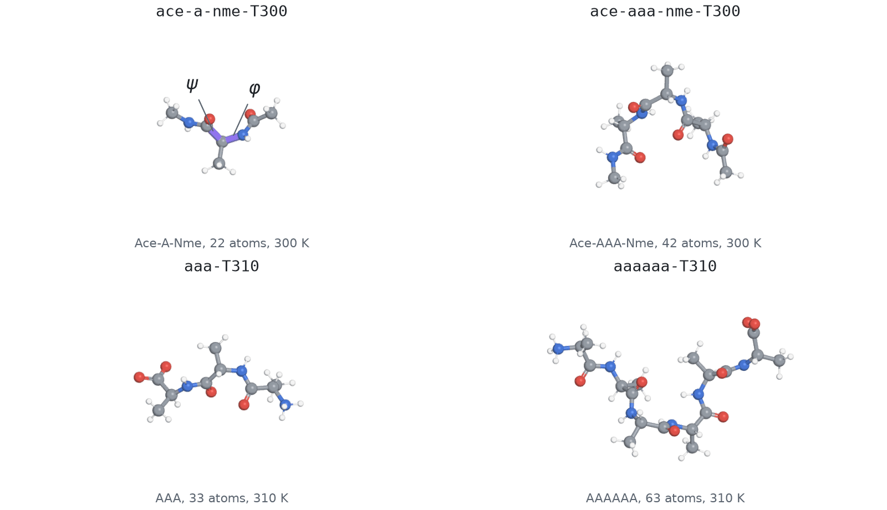
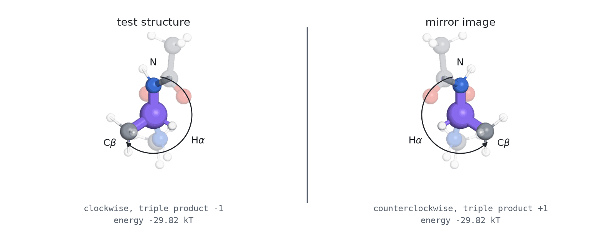
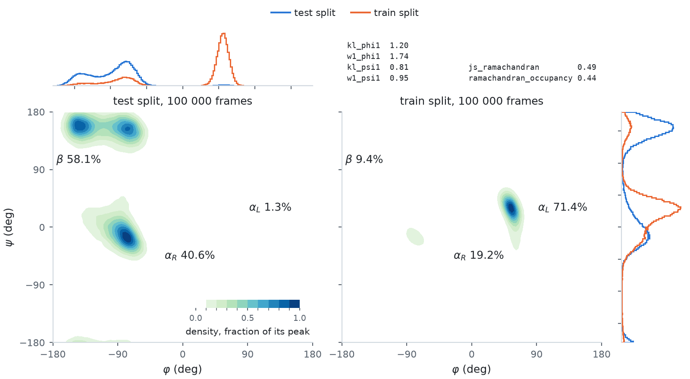
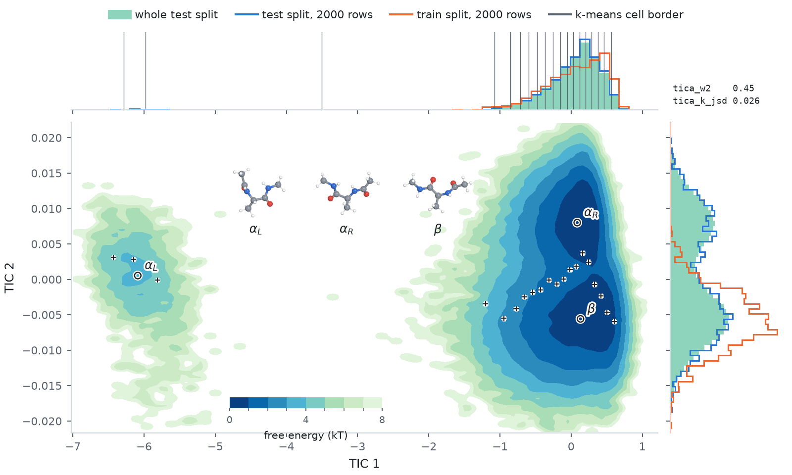
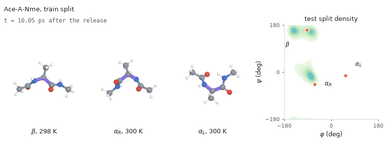

# Peptides (Tier 3)

Four peptides from the Sequential Boltzmann Generators dataset
(`transferable-samplers/sequential-boltzmann-generators-data` on Hugging Face, MIT). `Peptide(sequence)`
builds any of them. Coordinates are Cartesian positions in nanometres, energies are in kT, and the
working dtype is float32. They need the `[molecular]` extra.

| Name | Sequence | Atoms | dim | T | Force field |
| --- | --- | --- | --- | --- | --- |
| `ace-a-nme-T300` | `Ace-A-Nme` | 22 | 66 | 300 K | amber99sbildn + tip3p + amber99_obc, `NoCutoff` |
| `ace-aaa-nme-T300` | `Ace-AAA-Nme` | 42 | 126 | 300 K | same |
| `aaa-T310` | `AAA` | 33 | 99 | 310 K | amber14-all + implicit/obc1, `CutoffNonPeriodic` at 2 nm |
| `aaaaaa-T310` | `AAAAAA` | 63 | 189 | 310 K | same |

The two force-field families at two temperatures make these four different densities, and a number
from one family does not compare with a number from the other. `AAA` and `AAAAAA` form the one
chain-length ladder at a fixed force field. `ace-a-nme-T300` is the alanine dipeptide of Köhler et
al. 2021, not the ff96 + OBC1 variant that `lollcat/fab-torch` evaluates; `ace-aaa-nme-T300` is the
Ala4 of Nam et al. 2025; `AAA` and `AAAAAA` come from Tan et al. 2025.
Every input file is read at a pinned revision of that dataset and checked against a pinned sha256
(`SBG_REVISION`, `SBG_CHECKSUMS`).

<picture>
  <source media="(prefers-color-scheme: dark)" srcset="../figures/images/peptides_molecules_dark.png">
  
</picture>

One structure from each test split, the one of median radius of gyration, drawn at the same scale.
On Ace-A-Nme the two bonds the panel's torsions turn about are marked: phi about N-Calpha and psi
about Calpha-C. Ace-A-Nme's panel reads `phi1` and `psi1` only; the longer peptides add one phi,
psi and omega per residue.

## The energy

OpenMM builds each system and owns every parameter: force-field files, atom typing and topology.
`TorchForceField` reads those parameters out of the built `openmm.System` and evaluates the potential
in batched torch. It covers the two families above and asserts on any force, constraint, switching
function or solvent setting it does not know. In float64 it agrees with OpenMM's `Reference`
platform to about 2e-6 kT on the energy and 1e-5 kJ/mol/nm on forces of order 4e3.
`tests/test_molecular.py` asserts that agreement per system (energies to 1e-5 kT, forces to 1e-4
kT/nm), and `gen/openmm_check/compare.py` asserts it again in float64 (energies to 1e-6 and forces
to 1e-4 of their rms) and reports the error force group by force group.

- `log_prob_and_grad` returns both from a single pass and is the call to use.
- `compile=True` (the default) runs the potential through `torch.compile`, about 2.2x faster after a
  one-off ~15 s per batch shape. Turn it off for short, interactive or shape-varying work. The eager
  path is used automatically whenever the graph has to survive the call.
- `differentiable_score=True` keeps the score differentiable for a loss built on it, at the cost of
  a retained backward graph. It is a plain attribute of `target.bridge` and can be flipped later.
- Energies above `energy_cut = 1e8` kT are softened logarithmically, `E -> 1e8 + log(1 + E - 1e8)`
  (bgflow's `linlogcut`), so an atomic overlap gives a large finite number, below `1e8 + 710` kT.
  The result is then clamped at `energy_max = 1e20` kT, which only an infinite energy reaches. Both
  constants are part of the specification.
- The batched Langevin integrator, the minimisation of the released structure and the bond and
  angle terms alone, the beta = 0 end of a solute-tempering path, are generator tooling and live in
  `gen/md/dynamics.py`.

## Metric panel

| Metrics | What they compare |
| --- | --- |
| `kl_<torsion>`, `w1_<torsion>` | each backbone torsion marginal (`phi1`, ..., `psi1`, ..., `omega1`, ...); the W1 is taken on the circle |
| `js_ramachandran`, `ramachandran_occupancy` | the first residue's phi/psi joint, on a 32 x 32 grid, and the fraction of that grid the reference fills |
| `dist_total_var`, `dist_w1`, `dist_out_of_range` | the interatomic distances |
| `energy_total_var`, `energy_out_of_range` | the energies, on edges derived from the reference |
| `energy_w1`, `energy_w2`, `torus_w2`, `tica_w2`, `tica_k_jsd`, `torus_k_jsd`, `n_ot_samples` | the panel of `transferable-samplers`, under its names |
| `correct_chirality_rate`, `uncorrectable_chirality_rate` | the fraction of samples with the reference's handedness, and the fraction a mirror image does not fix |

Every Amber term is invariant under the inversion x -> -x, so a sampler that visits the mirror image
of the reference's conformations samples the target exactly. Before anything is compared, each
sample whose chirality centres disagree with the reference's is mirrored, as `transferable-samplers`
does: a centre is an atom with four bonds, at least three of them to heavy atoms, and its
handedness is the sign of the triple product of three bond vectors. A sample whose centres disagree
with each other has no mirror image in the reference and is scored as it is.

<picture>
  <source media="(prefers-color-scheme: dark)" srcset="../figures/images/peptides_chirality_dark.png">
  
</picture>

A test structure of Ace-A-Nme and its mirror image, seen down the bond from the alpha carbon to the
carbonyl carbon. The two have the same energy. Seen this way the bonds to N, H alpha and C beta
turn clockwise in the test structure and counterclockwise in the mirror image, and the triple product
of the three bond vectors, which the panel reads, changes sign. A sample of the mirror
handedness is mirrored back before scoring, and `correct_chirality_rate` is the fraction that did
not need it.

The `transferable-samplers` row reproduces their metrics in batched torch and is checked against
their implementation: `energy_w1`, `energy_w2` and `tica_w2` agree to 1e-12, `torus_w2` and the TICA
features to 1e-7, and the k-means divergences fall inside scikit-learn's own seed spread.
`compute_upstream_metrics` returns that panel alone. `torus_w2`, `tica_w2` and `tica_k_jsd` run on
`max_ot_samples` (2000) rows per side, reported back as `n_ot_samples` and drawn as the standard
panel draws its quadratic metrics' rows: a uniform subset without weights, a resample in proportion
to the weights with them. `generator` drives that draw, and is seeded at 0 when not given. The
energy distances and `torus_k_jsd` use every sample with its weight.

- `torus_w2` is exact transport on all phi and psi at once, with the per-coordinate distance
  `min(|d|, 2 pi - |d|)`. `tica_w2` is exact transport on the first two TICA components, and the two
  `*_k_jsd` are Jensen-Shannon divergences of 20 k-means cluster populations, on the TICA plane and on
  the sin/cos-wrapped dihedrals.
- TICA is deeptime's Koopman-reweighted TICA at lag 100, fitted once on the whole released test
  split in file order, as `transferable-samplers` fits it, and cached per system. The fit draws no
  random numbers. Its input features are ordered as upstream orders
  them: C, N and S upper-triangular distances, then sin and cos of phi, of psi and of omega.
  `TICA_LAYOUT` names that ordering in the cache file.
- A Ramachandran pair takes phi and psi of the same residue, matched through mdtraj's atom indexes.
  On the uncapped `AAA` and `AAAAAA`, mdtraj's phi and psi arrays are offset by one residue.
- The divergences use 64 bins per marginal and a 32 x 32 joint. `return_hist=True` returns a dict
  with `'torsions'` (the 200 x 200 plot-grade Ramachandran histograms and every torsion marginal),
  `'dist'` and `'energy'` (the structural histograms, on edges derived from the reference), and
  `'upstream'`, the upstream histograms: `'energy'`, `'distances'` and `'com_norm'` on edges
  spanning both sets, one Ramachandran per residue under `'ramachandran'`, and the TICA plane under
  `'tica'`.

<picture>
  <source media="(prefers-color-scheme: dark)" srcset="../figures/images/peptides_ramachandran_dark.png">
  
</picture>

Ace-A-Nme's two splits, every frame of each. The two planes are the Ramachandran densities of the
test split and of the train split, each in ten levels of its own peak and labelled with the share
of each backbone basin, counting alpha-R as phi < 0 and -125 < psi < 50 degrees and alpha-L as
phi > 0. Above and to the right are the phi and psi marginals of both splits, which `kl_phi1`,
`w1_phi1`, `kl_psi1` and `w1_psi1` compare, on bins finer than the panel's. The train split places
most of its frames in alpha-L, which the test split barely visits, so the test density stays below
its first level there and the train density peaks. Beta and PII, the test split's largest basin,
fall below the first level of the train density, and the phi marginal puts the bulk of the two
splits on opposite sides of phi = 0.

<picture>
  <source media="(prefers-color-scheme: dark)" srcset="../figures/images/peptides_tica_dark.png">
  
</picture>

The TICA plane of the upstream panel on the same two splits: the density of the test split, the
marginals of both splits, the k-means centres of `tica_k_jsd`, and the test structure nearest the
median of each backbone basin. The centres are fitted as the panel fits them, on its subsample of
the test split (`max_ot_samples` rows); everything else uses every frame. TIC 1 spreads far wider
than TIC 2, so the cells are bands across TIC 1, and the top marginal draws their borders. Alpha-R
and beta separate along TIC 2, which the cells barely resolve. Alpha-L is the island on the left,
below the first level of the test density. The TIC 1 marginal shows the train split's frames
gathered there, and on TIC 2 the train marginal peaks between the test split's alpha-R and beta
peaks.

## Splits

| Split | How it is built |
| --- | --- |
| test | This library's replica-exchange molecular dynamics with solute tempering, `gen/md/generate.py`, published as `md/<name>_<spec_id>.npy` and downloaded on first use: 100 000 structures. Its integrator is unadjusted BAOAB at 1 fs, which puts the mean energy about 0.1 kT above the exact law (measured on Ace-A-Nme). See [Reference sets](../reference-sets.md#replica-exchange-md-peptides). |
| `load_split('train' \| 'val' \| 'test')` | The released SBG frames, centred on load. The TICA projection is fitted on the test split; they are not a reference set. |
| train | 1000 Langevin trajectories (BAOAB, the system's friction, 1 fs) from the minimised released structure, each residue placed in a backbone basin: beta/PII, alpha-R or alpha-L with shares 7%, 22% and 71%, its phi and psi rotated to the basin's centre. A short descent and 2 ps of dynamics with the torsions restrained relax the rotation, then trajectory `i` runs free at the system's temperature times a factor running geometrically from 0.6 to 1.25 with `i`: 10 ps, then one frame every 50 fs. Alpha-L holds 60% to 70% of every residue against at most 3% in the test splits, inside a basin the shape is the target's, and every test energy lies inside the train range. |

<picture>
  <source media="(prefers-color-scheme: dark)" srcset="../figures/images/peptides_trajectory_dark.gif">
  
</picture>

Three trajectories of Ace-A-Nme's train split played back frame by frame, one per backbone basin,
each superposed on the backbone of its first frame, next to their (phi, psi) over the density of
the test split. Every trajectory of the recipe starts from the energy-minimised released structure
with each residue's phi and psi rotated to the centre of a basin drawn for it, alpha-L most often
and beta least. A restrained descent and a short restrained Langevin run relax the rotation, the
restraint is released, and the trajectory runs free at its own temperature, the temperatures
spread from below to above the system's, before its frames are kept. These three are the ones
nearest the system's temperature, and the clock counts from the release. Each stays in its basin
for nearly every frame, so the basin proportions of the train split follow the draw.

About the released files: the train split is mean-centred and val and test are not, which
`load_split` corrects.
