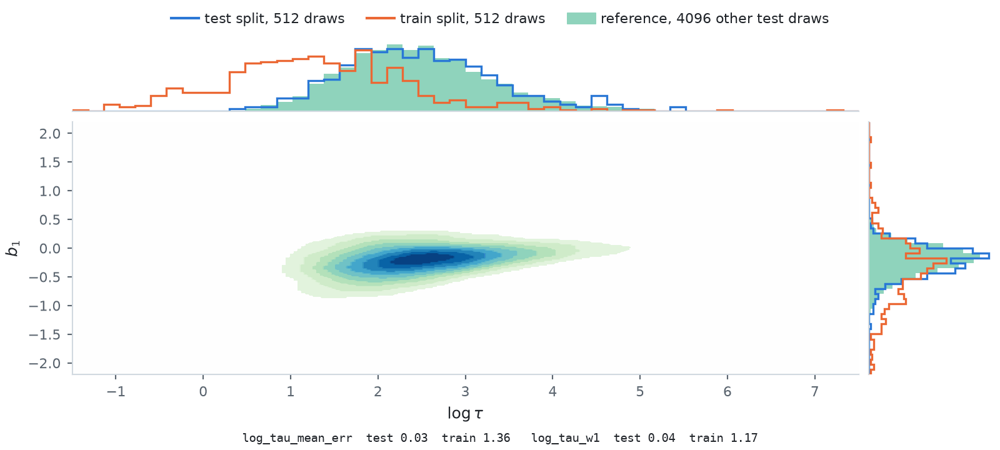
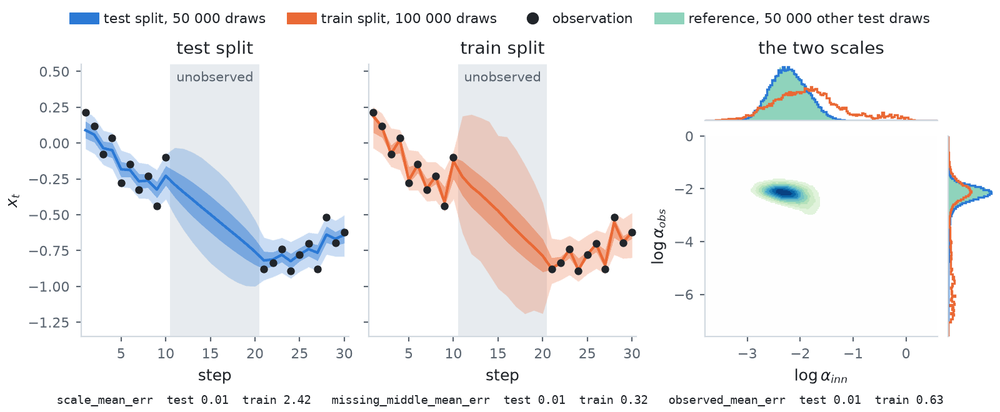
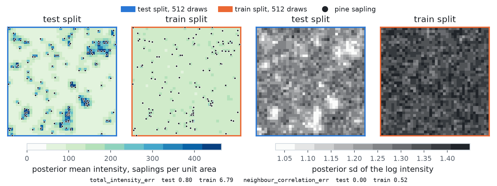
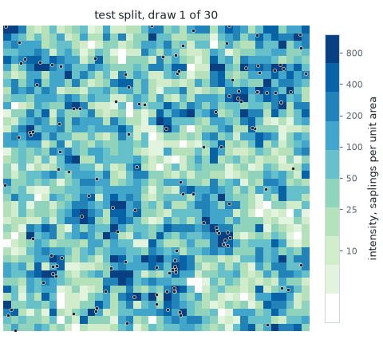
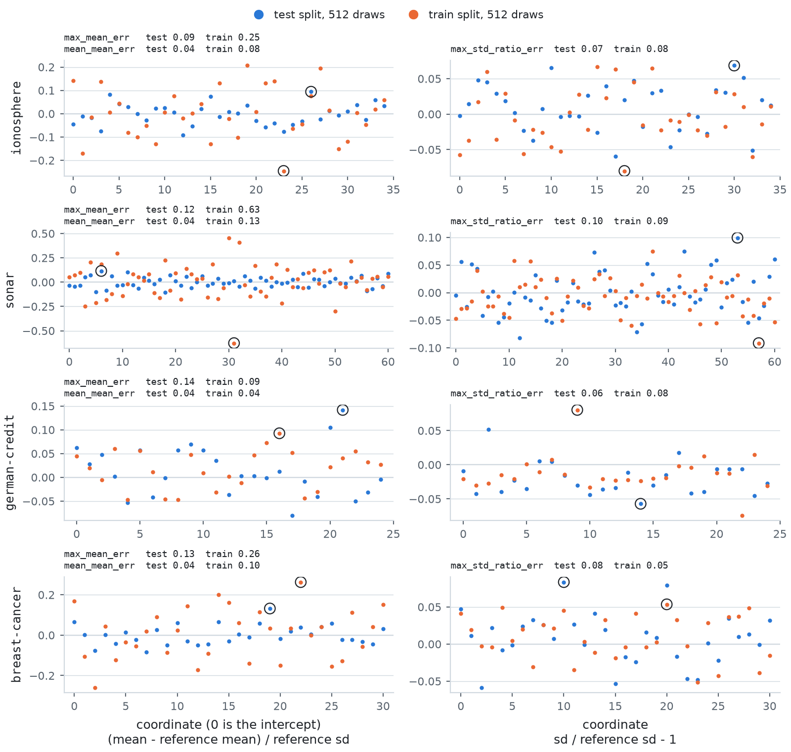

# Bayesian posteriors (Tier 2)

Seven posteriors, each in an unconstrained parameterisation with its log-Jacobian written out by
hand. They work in float64. None has a known `log Z` or a published reference ensemble (Blessing et
al. 2024 report only ELBO and EUBO on them), so the references are this library's Stan runs and,
for `brownian`, an exact sampler.

| Target | dim | `name` | Model |
| --- | --- | --- | --- |
| `LogisticRegression('ionosphere')` | 35 | `ionosphere` | Bayesian logistic regression, `w ~ N(0, I)` |
| `LogisticRegression('sonar')` | 61 | `sonar` | same |
| `LogisticRegression('german_credit')` | 25 | `german-credit` | same |
| `LogisticRegression('breast_cancer')` | 31 | `breast-cancer` | same |
| `Seeds` | 26 | `seeds` | random-effect binomial regression on the seeds data of Crowder (1978) |
| `Brownian` | 32 | `brownian` | `inference_gym`'s Brownian motion with two unknown scales and ten unobserved middle steps |
| `LGCP` | 1600 | `lgcp`, `lgcp-whitened` | log Gaussian Cox process on the 126 Finnish pine saplings, 40 x 40 grid |

The datasets are fetched from `DenisBless/variational_sampling_methods` at a pinned commit and
checksum.

## Models

**Logistic regression.** `log p(w) + sum_i [y_i s_i - softplus(s_i)]` with `s_i = w . u_i`. Features
are standardised, a bias column is prepended, so coordinate 0 is the intercept, and `sigma_w = 1`.
The same documented model is used for all four datasets. The hub implements German Credit and
Breast Cancer differently (features scaled without centring, prior scale 10, then the prior
omitted), so its reference-draw files for those two come from another density.

**Seeds.** `tau ~ Gamma(0.01, 0.01)`, `a_0, a_1, a_2, a_12 ~ N(0, 10^2)`, `b_i ~ N(0, 1 / tau)`,
and `r_i ~ Binomial(N_i, sigmoid(a_0 + a_1 x1_i + a_2 x2_i + a_12 x1_i x2_i + b_i))`. Coordinates
are `[a_0, a_1, a_2, a_12, b_1 .. b_21, log tau]`. The vague prior on `tau` makes `log tau` the neck
of a funnel.

<picture>
  <source media="(prefers-color-scheme: dark)" srcset="../figures/images/posteriors_seeds_dark.png">
  
</picture>

The density of `log tau` and the first random effect `b_1` from one half of the test split, with
the marginals of the other half and of the train split on its edges. A small `tau` lets every `b_i`
spread out, which is the wide end of the funnel. The train split comes from MALA chains started
from `N(0, 2^2 I)`, each on the posterior tempered to its own temperature, from slightly colder
than the posterior to three times hotter. On the top marginal it sits far into the wide end, at
smaller `log tau` than the test split, so its `b_1` marginal on the right is wider. The two test
halves agree, which is the floor `log_tau_mean_err` and `log_tau_w1` are read against.

**Brownian.** `alpha_inn, alpha_obs ~ LogNormal(0, 2)`, `x_1 ~ N(0, alpha_inn)`,
`x_i ~ N(x_{i-1}, alpha_inn)`, and `y_i ~ N(x_i, alpha_obs)` observed for `i` in 1..10 and 21..30.
Coordinates are `[log alpha_inn, log alpha_obs, x_1 .. x_30]`. The two scales form the second
funnel of the tier, and the middle ten steps are constrained only by the random walk.

<picture>
  <source media="(prefers-color-scheme: dark)" srcset="../figures/images/posteriors_brownian_dark.png">
  
</picture>

The posterior of the path `x_t` (median, 50 % and 90 % bands) from the test and train splits,
with the 20 observations as dots and the ten unobserved steps shaded. On the right, the density of
the two log scales from one half of the test split, with the other half and the train split in its
marginals. The test bands widen over the gap, where only the random walk constrains the path. The
train split comes from MALA chains on the posterior tempered from slightly colder than it to half
again as hot, started with both log scales drawn uniformly over a wide range and the locations at
the observations. Its bands are wider over the gap, its innovation scale is too large, and its
observation scale reaches far down the neck of the funnel: chains started deep in the neck stay
there, which is the long tail of the right marginal.

**LGCP.** `log N(x; mu, K) + sum_i [x_i c_i - a exp(x_i)]` with an exponential kernel
`K = sigma^2 exp(-|m - n| / (40 beta))`, `sigma^2 = 1.91`, `beta = 1/33`,
`mu = log(126) - sigma^2 / 2` and `a = 1/1600`. `LGCP()` samples `x` directly, the setting of
Blessing et al. 2024. `LGCP(whitened=True)` samples `e` with `x = L e + mu`; it is a different
geometry with its own name. Both have a Stan reference set, but the direct one needs a dense
1600 x 1600 triangular solve per gradient: its run takes 29 hours, against 30 minutes for the
whitened one.

<picture>
  <source media="(prefers-color-scheme: dark)" srcset="../figures/images/posteriors_lgcp_dark.png">
  
</picture>

The posterior mean of the intensity `exp(x)`, with the 126 saplings on top, and the posterior
standard deviation of `x`, from the test and train splits of `lgcp`, each quantity on one shared
scale. The test split puts the intensity where the saplings cluster and is most certain there. The
train split comes from MALA chains started from the Gaussian prior `N(mu, K)`, each on the
posterior tempered from slightly colder than it to three times hotter. It finds the same clusters,
but its field is more uncertain everywhere and its intensity is higher between the saplings, so it
expects more saplings in total (`total_intensity_err`) and its neighbouring cells covary more
(`neighbour_correlation_err`). Both are scored against the other half of the test split, and the
first half's score is their floor.

<picture>
  <source media="(prefers-color-scheme: dark)" srcset="../figures/images/posteriors_lgcp_draws_dark.gif">
  
</picture>

Single draws of the intensity field, a test draw on the left and a train draw on the right in
every frame, on one linear scale whose top is set by the test draws. The draws are rows evenly
spaced over each split, so the train frames come from chains across the recipe's whole range of
temperatures. Each draw is far rougher than the posterior mean: the kernel correlates cells over
40 beta = 1.2 cells, the structure `neighbour_correlation_err` measures. The train draws carry more
cells above the top of the scale.

## Metric panel

Every posterior reports moments relative to the reference spread:

| Metric | What it compares |
| --- | --- |
| `max_mean_err`, `mean_mean_err` | posterior means, in reference standard deviations, worst and average over coordinates |
| `max_std_ratio_err` | the worst ratio of standard deviations, minus one, both divided by `n` |
| `w1_first_coordinate` | 1D Wasserstein on coordinate 0 |

`return_hist=True` gives the per-coordinate `mean`, `ref_mean`, `std` and `ref_std`.

<picture>
  <source media="(prefers-color-scheme: dark)" srcset="../figures/images/posteriors_moments_dark.png">
  
</picture>

What `return_hist=True` holds, drawn per coordinate for the four logistic regressions: the error of
the posterior mean in reference standard deviations (left) and of the standard deviation (right).
The train split and one half of the test split are scored against the other half, so the test
points are the floor the train split is read against. The ringed points are the coordinates the
`max_*` metrics report. The train chains start from the prior `N(0, I)` and run on the posterior
tempered from slightly colder than it to three times hotter, so the train split is too wide on
every coordinate and its means scatter on both sides of the reference's, while the test half
sits on zero.

Each posterior then adds the quantities it is judged on, because an average over coordinates hides
the hard one:

| Target | Metrics |
| --- | --- |
| logistic regressions | `predictive_log_likelihood_err` on the log pointwise predictive density `mean_i log sum_s w_s p(y_i \| x_s)`, `predictive_accuracy_err` on the accuracy of the posterior predictive thresholded at one half |
| `Seeds` | `log_tau_mean_err` and `log_tau_w1` on the neck of the funnel, `max_fixed_effect_err` on the four fixed effects |
| `Brownian` | `scale_mean_err` on the two scales, `missing_middle_mean_err` on the unobserved steps, `observed_mean_err` on the observed ones |
| `LGCP` | `total_intensity_err` on `sum_i a exp(x_i)`, which the 126 observed pines pin; `neighbour_correlation_err` on the covariance of adjacent cells about the reference's mean field, which the kernel's correlation length sets |

Each of these compares the samples with the reference draws; the logistic and LGCP entries are the
absolute difference between the two sets' values. Read each number against its floor, the same
metric between two halves of the reference set. The funnels (Seeds, Brownian) have percent-level
floors where the logistic regressions are sub-percent.

The predictive density averages each data point's likelihood over the samples before the
logarithm (the lppd of Gelman, Hwang and Vehtari 2014, divided by the number of data points), so it
converges as the sample count grows.

## Splits

| Split | How it is built |
| --- | --- |
| test | Stan, `gen/stan/generate.py`, published as `stan/<name>_<spec_id>.npy` and downloaded on first use. The Stan models are written in this library's coordinates and checked against the torch density before sampling. See [Reference sets](../reference-sets.md#stan-posteriors). |
| test, `brownian` | Exact draws, `gen/exact/brownian.py`, published as `exact/brownian_<spec_id>.npy`. See [Reference sets](../reference-sets.md#exact-sampler-brownian-motion). |
| train | 1000 MALA chains, chain `i` on the tempered posterior at a factor running geometrically from 0.8 to 3 with `i` (to 1.5 on `brownian`). The step size of every chain adapts towards 57% acceptance over 1000 moves, after which each keeps one state every 10 moves. The chains start from `N(0, prior_scale^2 I)`, the prior of the logistic regressions; `LGCP` from its Gaussian prior `N(mu, K)`; `brownian` across both of its funnels, with uniform log scales and the locations at the observations. The split is overdispersed in every coordinate and spans the test energies at both ends. |

Brownian's exact reference gives scale means of 0.1156 (innovation) and 0.1127 (observation).
`inference_gym`'s published ground truth gives 0.11985 and 0.10105, up to 0.31 posterior standard
deviations away, so read the panel against this library's reference.
