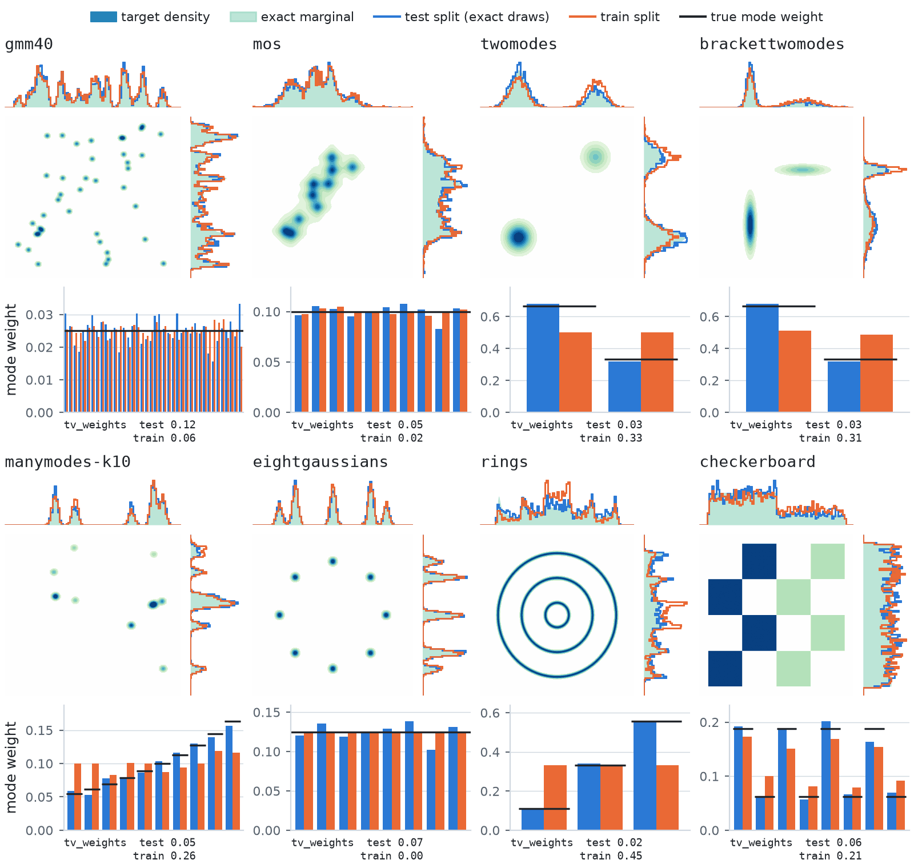
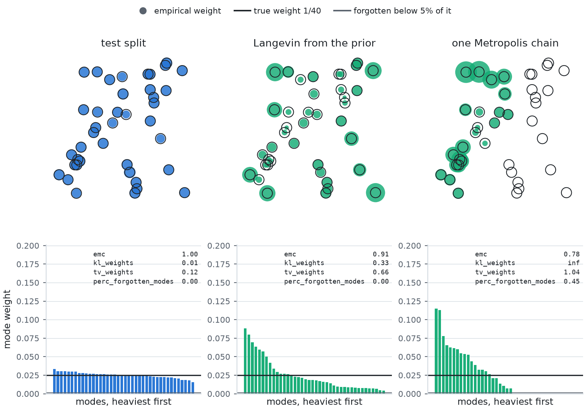
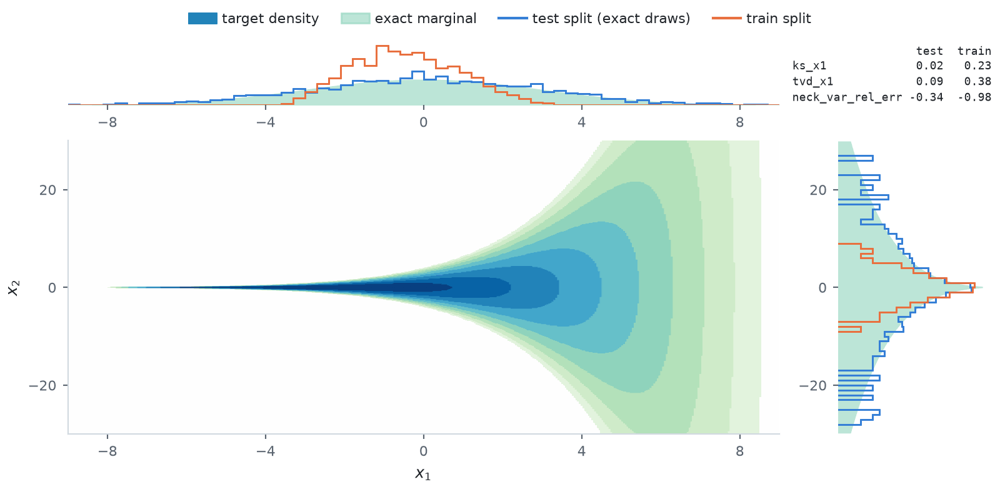
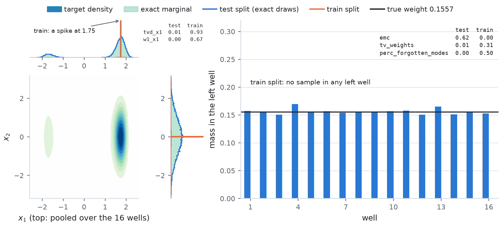

# Synthetic targets (Tier 0)

Closed-form densities whose reference samples are exact draws. They work in float64, and a float32
build has the same `spec_id`: the constants that define each density are hashed in float64 whatever
the working dtype.

| Class | dim | `name` | Density |
| --- | --- | --- | --- |
| `Funnel` | 10 | `funnel` | Neal's funnel: `x_1 ~ N(0, 3^2)`, `x_{2:d} \| x_1 ~ N(0, exp(x_1) I)`. The 3 is a scale, not a variance |
| `GMM40` | 2, any | `gmm40` | 40 equally weighted unit-variance Gaussians with means uniform in [-40, 40]^d (Midgley et al. 2023, Blessing et al. 2024) |
| `MoS` | 2, any | `mos` | 10 equally weighted Student-t components with 2 degrees of freedom, so infinite variance, means uniform in [-10, 10]^d and at least 5 apart (Blessing et al. 2024; the separation is ours) |
| `ManyWell` | 32, any even | `manywell` | `d/2` independent tilted 2D double wells, `E = a x_1 + b x_1^2 + c x_1^4 + x_2^2 / 2` with `(a, b, c) = (-0.5, -6, 1)` (Wu et al. 2020) |
| `TwoModes` | any | `twomodes` | `(2/3) N(-1, 0.05 I) + (1/3) N(+1, 0.05 I)` |
| `BracketTwoModes` | any | `brackettwomodes` | two modes at ±0.75, weighted 2/3 : 1/3, whose diagonal variances ramp from 0.01 to 0.2 in one and from 0.2 to 0.01 in the other |
| `ManyModes` | any | `manymodes-k<K>` | `K` Gaussians (3 by default) at seeded uniform locations in `[-K, K]^d`, variance 0.1, weights rising geometrically to 3x |
| `EightGaussians` | 2 | `eightgaussians` | eight equally weighted Gaussians on a circle of radius 2, scale 0.1 |
| `Rings` | 2 | `rings`, `rings-equal` | radius a Gaussian mixture at 1, 3, 5 with scale 0.1, angle uniform, weights proportional to the radius (equal with `equilibrated=True`) |
| `Checkerboard` | 2 | `checkerboard` | eight uniform 2 x 2 squares, every second one three times heavier |

<picture>
  <source media="(prefers-color-scheme: dark)" srcset="../figures/images/synthetic_splits_dark.png">
  
</picture>

Each 2D target's density in ten levels, each a tenth of its peak, with the marginal histograms of
both splits over the exact marginals, and below it the empirical mode weights of both splits
against the true ones. ManyModes is drawn with ten modes, `ManyModes(n_modes=10)`; the catalog's
`manymodes-k3` has three. Each train chain picks a mode, the heavier modes less often, starts from
an exact draw of that mode and takes a few random-walk Metropolis steps. The marginals show every
mode at its local shape in both splits. The bars show the test split on the true weights and the
train split giving the heaviest modes the least mass, and on the equally weighted mixtures a mass
that rises with the mode index.

`Rings` and `Checkerboard` follow the layout of `h2o64/sde_sampler_lrds`. The parameters of
`EightGaussians` are a choice: no two papers use the same ones.

Details that matter when comparing with other implementations:

- The GMM-40, MoS and ManyModes means are drawn by a seeded PyTorch generator, in float32 whatever
  the working dtype, so a float64 build has the same locations. `tests/test_target_specs.py`
  asserts the sha256 of the GMM-40 and MoS matrices at 2, 50 and 200 dimensions: the matrix is the
  specification, not the seed. The papers drew theirs with JAX, whose generator changed across
  versions, so the locations differ from theirs while the construction is the same. MoS also skips
  any draw within five scales of a mean already kept, so that its heavy tails do not merge two
  modes; in 50 and 200 dimensions no draw is skipped.
- ManyWell's coordinates are interleaved: even indexes carry the quartic, odd ones the Gaussian. The
  tilt puts 15.57% of each well's mass on the left and 84.43% on the right, and `log Z = 164.696`
  at `d = 32`.
- Rings' density diverges at the origin through the polar Jacobian `-log |x|`. It is integrable and
  no sampler visits it.
- Checkerboard's score is identically zero wherever the density is finite, and `log_prob` is `-inf`
  off the board. It is a coverage test for samplers that use `log_prob`.

## Metric panel

Every synthetic target reports the [standard panel](../metrics.md#the-standard-panel), then its own:

| Targets | Metrics | `return_hist=True` gives |
| --- | --- | --- |
| `GMM40`, `MoS`, `TwoModes`, `BracketTwoModes`, `ManyModes`, `EightGaussians` | `emc`, `kl_weights`, `tv_weights`, `perc_forgotten_modes` on the mean component responsibilities | the empirical mode weights, `(1, n_modes)` |
| `Rings`, `Checkerboard` | the same four, on the nearest ring and on which square | the same |
| `ManyWell` | the four per well, averaged over wells, plus `tvd_x1`, `x1_out_of_range`, `w1_x1` and `x1_mean_err` against the exact pooled quartic marginal | the per-well weights, `(n_wells, 2)` |
| `Funnel` | `ks_x1`, `tvd_x1`, `x1_out_of_range`, `x1_mean_err`, `x1_var_err` and `neck_var_rel_err` against the analytic `N(0, 9)` marginal of `x_1` | the `x_1` histogram and its exact counterpart |

The mixtures' empirical mode weights are mean responsibilities, whose expectation under exact draws
is the mixture weights even where components overlap; see [Mode coverage](../metrics.md#mode-coverage).
On `TwoModes` and `BracketTwoModes` the heavy mode's weight is `hist[0, 0]` of `return_hist=True`, and
`tv_weights` is twice its error. ManyWell's panel is per well because no finite sample can populate
its `2^(d/2)` joint modes, while the per-well marginals are estimable.

<picture>
  <source media="(prefers-color-scheme: dark)" srcset="../figures/images/synthetic_mode_coverage_dark.png">
  
</picture>

GMM-40 under exact draws and under two samplers that illustrate the coverage numbers, neither of
them the train split. Each mode is a disc whose area is its empirical weight, inside a ring whose
area is the true weight 1/40. The exact draws fill every ring. The unadjusted Langevin loop of the
README, run from the prior on as many particles as there are exact draws, reaches every mode with
the wrong weights. One random-walk Metropolis chain from the first mean, thinned, keeps fewer
states than the other two sets because its steps run one at a time. It leaves a group of rings
empty, which `perc_forgotten_modes` counts and `kl_weights` grows with, while `emc` reads about
what it reads under Langevin.

<picture>
  <source media="(prefers-color-scheme: dark)" srcset="../figures/images/synthetic_funnel_dark.png">
  
</picture>

The exact density of the funnel's first two coordinates, with the marginals of both splits over
the exact ones. Each train chain starts with `x_1` uniform on [-12, 12] and the other coordinates
from their exact conditional, then takes random-walk Metropolis steps that move the wide end and
leave the neck in place. The top panel shows the train `x_1` flat across neck and wide end against
the exact Gaussian, and the right panel the train `x_2` peaked at zero, from the chains that stay in
the neck. `ks_x1` and `tvd_x1` compare `x_1` with its exact `N(0, 3^2)`. `neck_var_rel_err` is the
relative error on `E[exp(x_1)]`, the variance of `x_2` to `x_10`. A few samples at large `x_1` carry
it, so the train split's far wide end inflates it, and exact draws scatter around zero: read it
against the exact draws' value.

<picture>
  <source media="(prefers-color-scheme: dark)" srcset="../figures/images/synthetic_manywell_dark.png">
  
</picture>

One of ManyWell's 16 identical double wells, with the marginals of both splits pooled over the
wells, and the mass on the left of each well, which is what the coverage panel reads. Each train
chain draws a probability uniformly, puts every well on its left side with that probability, starts
at that side's minimum and takes MALA steps that relax each well without crossing the barrier. Both
splits cover both sides of every well. The test split sits on the true left mass, and the train
split puts as much of every well on the left as on the right. The Gaussian coordinate matches in
both splits.

## Splits

| Split | How it is built |
| --- | --- |
| test | Exact draws, seeded at 0. ManyWell inverts the 1D quartic CDF per well, Rings draws a radius then an angle, Checkerboard picks a square by weight then a uniform point in it. |
| train, mixtures, `Rings`, `Checkerboard` | Each chain draws a mode with shares geometric from 1 to 10 against the ranking by true weight (the heaviest mode gets the least, and equal weights get the skew along the index order), starts from an exact draw of that mode, and takes 20 random-walk Metropolis steps: of size `2.4 min_scale / sqrt(dim)` on the Gaussian mixtures, half a component scale on `MoS`, the ring width on `Rings`, 0.5 on `Checkerboard`. Every mode is visited with its local shape; at n = 10^5 `tv_weights` reads 0.41 (`GMM40`) to 1.19 (`Rings`) against at most 0.012 for exact draws. |
| train, `Funnel` | `x_1` uniform on `[-12, 12]`, the other coordinates from their exact conditional, then 200 random-walk steps of size 0.5, which move the wide end and not the neck. Neck and wide end are both covered; the standard deviation of `x_1` is 6.9 against 3. |
| train, `ManyWell` | Each chain draws `p` uniformly and puts every well on its light side with probability `p`, starts at that side's minimum with an exact `N(0, 1)` Gaussian coordinate, and takes 200 MALA steps of size 0.02, below the barrier. Both sides of every well are visited, each half the time against 15.57% / 84.43%. |
